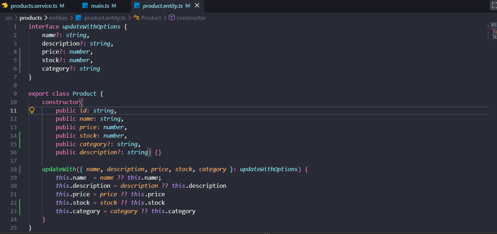
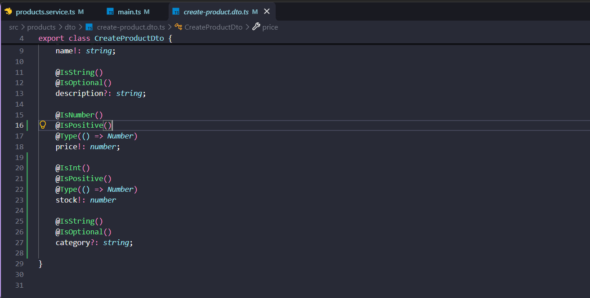
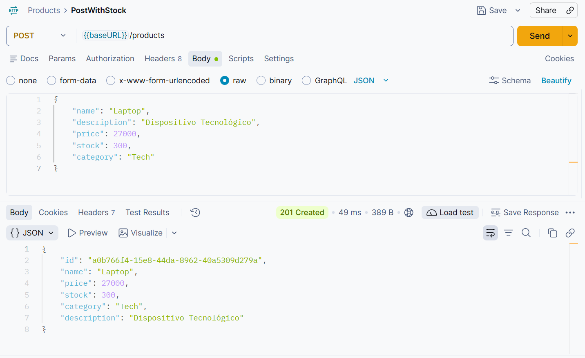
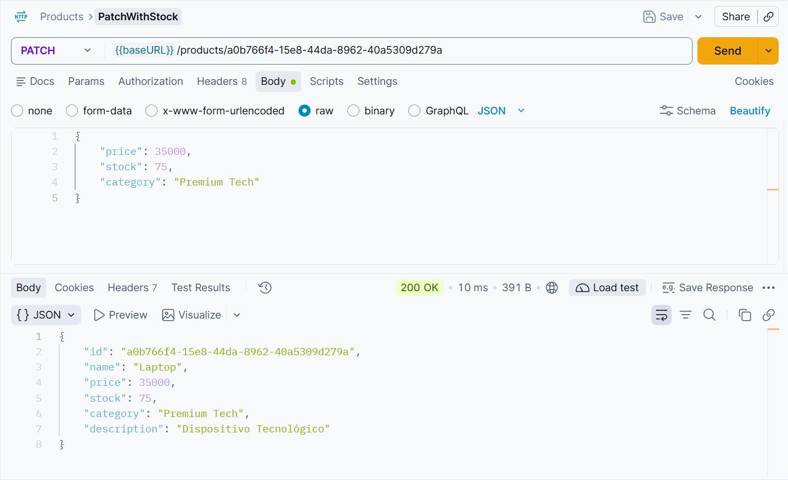
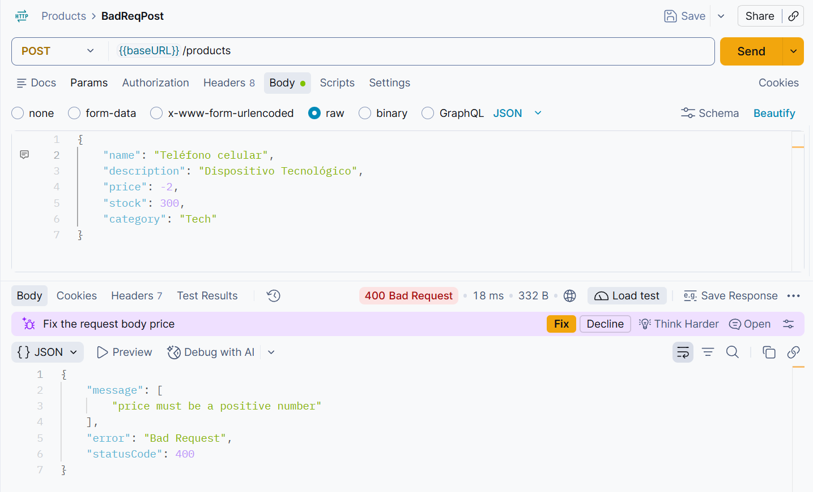

Tarea 2:

Se agregó el stock y categoría al Entity (Product), así como a updateWith junto a su interfaz.

Se agregaron los Validators de stock y category al Dto.

Se hace la creación mediante POST de un producto con los nuevos campos: stock y category

Se hace la actualización de los campos stock y category del producto mediante Patch 

Se intenta realizar un Post con un price negativo, entonces responde BadRequest 400: "price must be a positive number"

